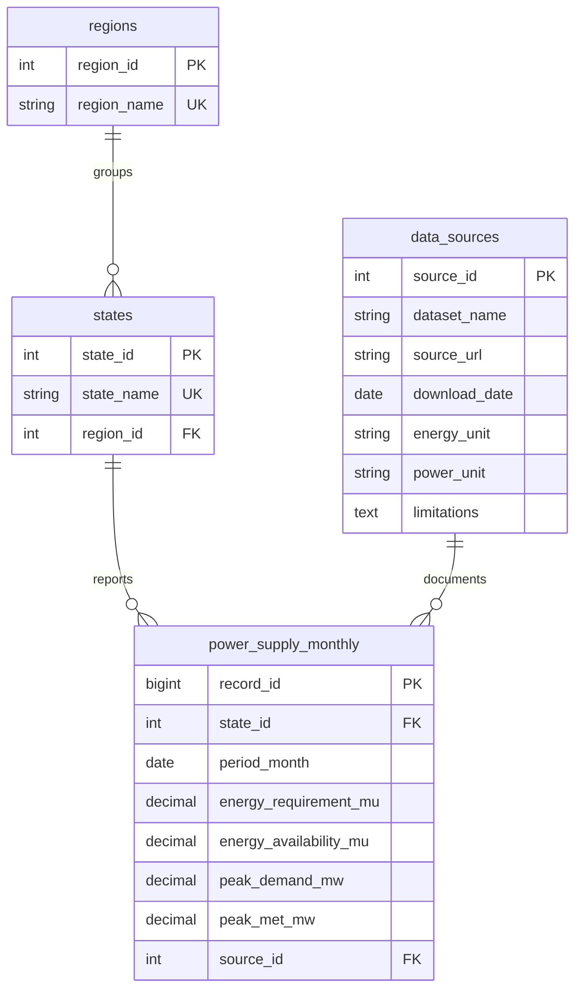

# Smart Electricity Consumption Analytics and Anomaly Detection

Streamlit + MySQL dashboard for Indian state-wise electricity **supply position** data from the
Central Electricity Authority (CEA). Python, Pandas, NumPy, Plotly, SQLAlchemy/PyMySQL, advanced
MySQL 8 SQL, Z-score/IQR anomaly detection. **No machine learning. No bundled or fabricated data.**

## Read this first: what the data can and cannot support
* CEA publishes **energy requirement / availability (MU)** and **peak demand / peak met (MW)** by state and month.
* CEA calls availability "net consumption including transmission losses". That is **not metered consumption**, so the
  "Consumption Analytics" page uses availability as a clearly labelled proxy.
* Peak demand is power (MW) and energy is MU (1 MU = 1 GWh). They are never added together, and peaks are never summed across states.
* See `docs/DATA_SOURCES.md` for sources, limits and the feature-to-data map.
* I could not reach the internet while building, so the app **cannot auto-download** and you upload files manually.

## Setup (step by step)

### 1. Install Python and MySQL
* **Python 3.10 - 3.12** (python.org). Check: `python --version`.
* **MySQL 8.0 or newer** (5.7 will NOT work: the SQL uses window functions and CTEs).
  * Windows: download "MySQL Installer" from dev.mysql.com/downloads/installer, choose *Server only*, set a root password, keep port 3306.
  * macOS: `brew install mysql && brew services start mysql`
  * Ubuntu/Debian: `sudo apt update && sudo apt install mysql-server && sudo systemctl start mysql`

### 2. Create a MySQL user (optional but recommended)
```sql
-- mysql -u root -p
CREATE USER 'elec_user'@'localhost' IDENTIFIED BY 'choose_a_password';
GRANT ALL PRIVILEGES ON electricity_analytics.* TO 'elec_user'@'localhost';
GRANT CREATE ON *.* TO 'elec_user'@'localhost';   -- lets the app create the database itself
FLUSH PRIVILEGES;
```
(You may instead use `root` while learning.)

### 3. Install the project
```bash
cd smart_electricity_analytics
python -m venv .venv
source .venv/bin/activate            # Windows PowerShell: .venv\Scripts\Activate.ps1
pip install -r requirements.txt
cp .env.example .env                 # Windows: copy .env.example .env
```
Edit `.env`: `DB_USER`, `DB_PASSWORD` (and `DB_HOST`/`DB_PORT`/`DB_NAME` if different). Never commit `.env`.

### 4. Check the setup and create the database
```bash
python scripts/check_setup.py --init-db
```
It checks packages, `.env`, the MySQL connection and version, creates the database and tables from `sql/schema.sql`,
and runs the data-quality queries on the empty tables. (Alternative: `mysql -u elec_user -p < sql/schema.sql`.)

### 5. Start the app (always from the project root)
```bash
streamlit run app.py
```
Open http://localhost:8501.

### Deploy to Streamlit Community Cloud
1. Push this project to GitHub and create a hosted MySQL 8+ database that accepts connections from Streamlit Community Cloud.
2. In Streamlit Community Cloud, create an app from the repository, select `app.py` as the entry point, and set the app's Python version to 3.12.
3. In the app's **Settings -> Secrets**, add the database values below. Keep this configuration private; do not commit `.env` or `secrets.toml`.

```toml
DB_HOST = "your-mysql-host"
DB_PORT = 3306
DB_NAME = "electricity_analytics"
DB_USER = "your-mysql-user"
DB_PASSWORD = "your-mysql-password"
```

4. Ensure the MySQL user can create the database and tables, or initialize `sql/schema.sql` on the hosted database before launching. Upload CEA files through **Data Management** after the app starts.

The app reads Streamlit secrets in the cloud and continues to use environment variables / `.env` for local development. A reachable hosted database is required; Community Cloud does not host MySQL for the app.

### 6. Import official CEA data
1. Get the files as described in `docs/DATA_SOURCES.md` (CEA publishes monthly reports as PDF; extract the state table to CSV/XLSX).
2. Use `data/raw/upload_template_HEADERS_ONLY.csv` as the column layout (it contains headers only, no data).
3. Open **Data Management** -> upload -> confirm column mapping and **units** -> review the Missing / Duplicates / State names / Excluded tabs.
4. Enter the dataset name and the official URL, tick the confirmation, choose skip/overwrite for existing rows, click **Import into MySQL**.
5. Open the other pages. With no data they show an empty-state message, never placeholder numbers.

Dates can be `2022-04-01`, `2022-04`, `Apr-2022`, or `01/04/2022` (day-first). Aggregate rows (All India, regions) are excluded and listed.

### Troubleshooting
| Symptom | Fix |
|---|---|
| "Cannot connect to MySQL" | MySQL not running, or wrong `.env` values; run `python scripts/check_setup.py` |
| `Access denied for user` | Wrong user/password, or the user lacks privileges (step 2) |
| `caching_sha2_password` / `cryptography` error | `pip install cryptography` (already in requirements) |
| SQL page error near `OVER` or `WITH` | MySQL older than 8.0 |
| `ModuleNotFoundError: src` | Run `streamlit run app.py` from the project root, not from inside `pages/` |
| Streamlit warnings about `use_container_width` | You installed Streamlit >= 1.50; use `pip install "streamlit<1.50"` |
| Browser console reports failed `webhooks.fivetran.com` requests while offline | Streamlit usage statistics are disabled for this project in `.streamlit/config.toml`; restart the app. A slow-network font fallback message is separate and nonfatal. |

## Project structure
```
app.py                     home / connection status
pages/                     1_Overview ... 6_Data_Management
src/config.py              units, constants          src/preprocessing.py  cleaning, state names, units
src/database.py            MySQL, import, SQL loader src/validation.py     missing/duplicate/range checks
src/analytics.py           growth, MA, gaps, KPIs    src/anomaly_detection.py  Z-score / IQR
src/ui.py                  shared Streamlit helpers
sql/                       schema + 22 executable queries (consumption, demand_supply, anomaly, data_quality)
tests/                     30 tests; synthetic_fixtures.py is SYNTHETIC test data only
docs/                      DATA_SOURCES.md, VIVA_NOTES.md
```

## ER diagram

`UNIQUE(state_id, period_month)` blocks duplicates; CHECK constraints block negatives and non-first-of-month dates.
Tables for consumer categories or per-capita data were deliberately not created because no source supports them.

## Architecture
Upload -> `preprocessing` (map, units, state names, aggregates out) -> `validation` (reports) -> user preview ->
`database.import_power_supply` (single transaction, skip/overwrite choice) -> MySQL -> `load_power_supply` -> `analytics`/`anomaly_detection` -> Plotly pages.
The Advanced SQL page runs `sql/*.sql` live on MySQL.

## Anomaly method (why it is not a naive Z-score)
Each value / its state's fiscal-year mean removes size and growth; it is then compared with the **same state and calendar month**
in other years. With n years per group the largest possible |z| is (n-1)/sqrt(n) (about 1.79 for n=5), so the app warns when your
threshold is unreachable. Anomalies are statistical signals, not proof of theft, faults or errors.

## Testing and what has actually been verified
```bash
pytest -q                               # unit tests (test_database.py also needs SQLAlchemy, installed via requirements)
python tests/smoke_pages_mocked.py      # runs every page's Python code against a FAKE Streamlit/Plotly/DB (synthetic data)
python scripts/check_setup.py           # REAL check of your packages, .env and MySQL connection
```
| Check | Status when this was built |
|---|---|
| 30 unit tests: units, state names, dates, validation, growth/MoM/YoY, moving average, fiscal years, KPIs, anomaly detection | **Passed** (run with a minimal pytest stand-in, since pytest could not be installed offline; they use plain asserts) |
| `tests/test_database.py` (connection-failure handling, SQL file parsing, schema constraints, duplicate guard) | **Not run** - needs SQLAlchemy; the SQL parser alone was checked with stubs (22 queries parsed) |
| Mocked smoke test of all 6 pages + app + db-down / empty-db paths + import payload | **Passed** (11 scripts + payload check). This proves the Python wiring only |
| `streamlit run app.py`, real rendering, widgets, Plotly charts | **NOT tested** (Streamlit/Plotly not installable offline) |
| MySQL connection, `init_schema`, `import_power_supply`, all 22 SQL queries | **NOT tested** (no MySQL available) |
| Behaviour with real CEA files | **NOT tested** (no CEA file was available; synthetic fixtures live only in `tests/`) |

Treat the untested rows as the first thing to verify on your machine. Bugs found by testing so far: ISO dates were being read day-first (fixed, with tests); numpy floats passed to PyMySQL (fixed); `.xls` upload without `xlrd` (removed); datetime rounding warning (fixed).

## Limitations
Few years per state-month group gives noisy baselines; provisional CEA figures may be revised; state coverage changes
alter national sums (shown in the app); linear trend is descriptive, not a forecast; benchmarks are not official efficiency ratings.
